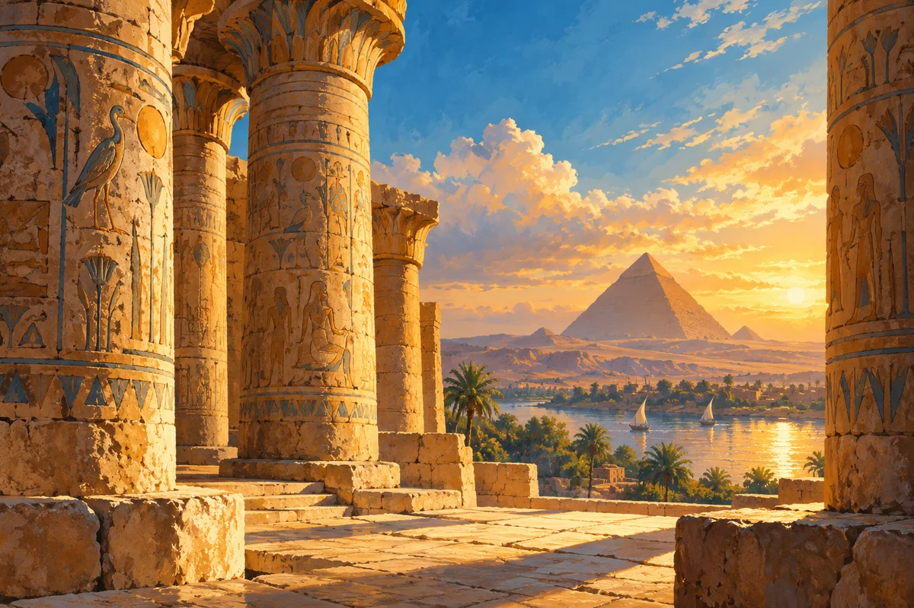

Choosing a Nile journey begins with the kind of time you want to spend aboard. Do you imagine a sociable deck and a structured programme, or a more intimate setting where the boat itself is a central part of the holiday?

The labels are a starting point, not a complete description. Compare the actual vessel and programme rather than assuming that every cruise ship—or every dahabiya—offers the same experience.

## Begin with the atmosphere you want

Think about the moments between visits. You may want quiet reading time, shared conversation or a clear sequence of activities. Describe that preference before looking at cabin photographs.

Travel companions matter too. A good choice works for the people sharing the journey, not only for the person organising it.

## A comparison that asks the right questions

| Question | A conventional cruise | A dahabiya-style journey |
| --- | --- | --- |
| What is the social setting? | Ask about the actual passenger spaces and group arrangements | Ask about the size and character of the particular vessel |
| How is time ashore organised? | Read the scheduled programme and inclusions | Check the proposed route and how plans are arranged |
| What is the cabin experience? | Compare the real cabin category and facilities | Review the actual room layout and amenities |
| How flexible is the holiday? | Read the product’s own terms | Ask the operator rather than assuming the label guarantees flexibility |

## Look at the route before the room

Luxor and Aswan can anchor a river itinerary, but direction and programme affect the experience. Look at the actual places included, the travel days and how the boat journey connects with the rest of your holiday.

The [Luxor-to-Aswan cruise package](package:nile_cruise_luxor_aswan_5d4n) is an existing option with its own details. It is not a stand-in for every type of vessel described here.

## Read the quiet details of the booking

A cabin name does not explain every meal, drink, visit or transfer. Make a list of the details that matter to you and compare the inclusions directly. Ask how special requests are handled before you treat them as agreed arrangements.

Consider the beginning and end of the journey as carefully as the nights aboard. A convenient connection can make the whole trip feel more relaxed.

## Match the boat to the people travelling

If your group has different interests, talk about them early. One person may want to join every visit; another may value a slow morning more. The best discussion is about the actual programme and spaces available, not a general claim that one boat style suits everyone.

Ask the operator about any individual access or participation needs. Images cannot establish whether a particular vessel will work for your group.

## Give the river some unscheduled attention

Whatever you choose, leave time simply to notice the landscape. A journey can become a succession of announcements and appointments if you let every interval fill itself. A quiet half-hour on deck can help the places you visited settle into a wider story.

## Make a decision you can explain

Finish this sentence: we chose this journey because we want more of… Quiet time, conversation, a particular route or a defined programme are all useful answers. A label alone is not.

For the wider planning conversation, return to [10 Common Traps Tourists Fall Into in Egypt (And How to Dodge Them)](post:en-demo-common-tourist-traps-egypt).
