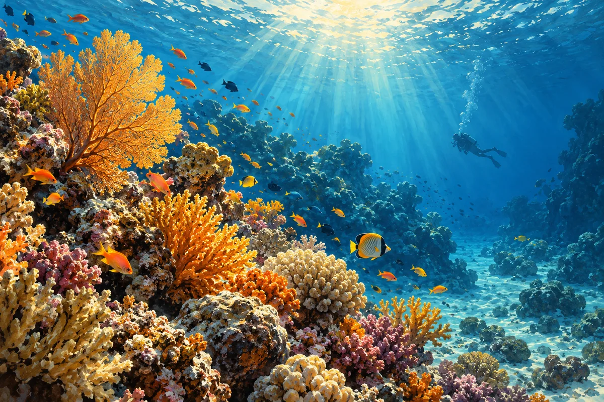

Organiza tu estancia costera con el equilibrio que prefieras entre salidas al mar, tiempo en tierra y días sin más horario que el del agua.

## Elige la experiencia, no solo la fotografía

Una salida en barco, una sesión guiada de esnórquel y una inmersión de buceo son actividades distintas. Lee la descripción real y pregunta al operador por los requisitos de la experiencia que te interesa.

Deja suficiente espacio en la semana para disfrutar de tu alojamiento. No necesitas convertir cada día en una excursión. El plan más útil equilibra las actividades que te importan con el descanso que has venido a buscar.

## Explora con responsabilidad

Mantén la distancia con la fauna y evita tocar los corales o ponerte de pie sobre ellos. Sigue las instrucciones del equipo cualificado responsable de tu actividad; un artículo general sobre un destino no sustituye las indicaciones individuales.

Ras Mohammed y Tirán aparecen en experiencias existentes de Fabio Egypt. Abre sus páginas de detalles para comparar las salidas reales en vez de suponer que todas las excursiones marítimas siguen la misma ruta.

Consulta la [excursión de un día relacionada](tour:ras_mohammed_white_island_vip) para conocer su itinerario real.

Si prefieres otro formato de viaje, consulta el [paquete relacionado](package:il_grande_blu).
