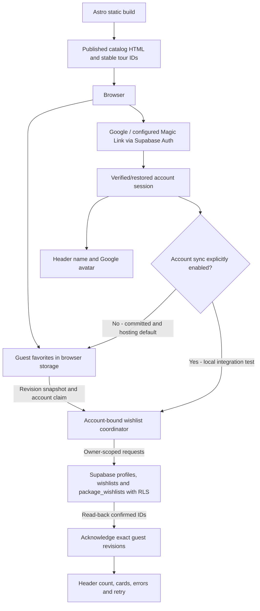

# Authentication, wishlists, and email reminders — Fabio Egypt

Created: 2026-10-23. English execution reference replacing the Arabic text.

**Current status — 2026-10-25:** restricted activation is deployed on the separate
Vercel test project and localhost. Google, account favorites, explicit reminder
consent/language and no-login management pages are enabled. Native activity,
queue and ownership assertions passed with ROLLBACK. Cron runs every 15 minutes;
Brevo webhook setup now returns 200/configured and webhook_ready=true. Restricted
activation is ready for user testing; actual email delivery is not yet verified.

## Decision autonomy — current instruction (2026-10-25)

Continue the agreed Auth/wishlist/reminder work autonomously. Choose routine
implementation details, copy consistent with approved content, tests, local file
changes and technical defaults using judgment; document material choices and
results instead of stopping to ask the user about every decision. Earlier wording
asking to agree/review/approve routine decisions is superseded by this instruction.
Ask only for genuinely missing information that blocks work or an action outside
standing authorization. Separate gates for new dependencies, external sending,
remote writes/settings and deployment/domain changes remain as recorded in
AGENTS.md; reuse existing explicit authorization rather than requesting it again.

## Current continuation checkpoint

- Current language target: the latest site language is the account email language,
  as defined in section 6.1. Older checkpoint entries below describe historical
  implementation/evidence and cannot override that target. Implementation alignment
  is pending; no deployment or remote preference write occurs in this plan update.

- Reminder language is now editable directly in the reminder form after first
  consent. Save uses the existing explicit correspondence endpoint, preserves
  consent/timing on language-only changes and keeps the same command on uncertain
  retries. At that checkpoint, site switching was not coupled; section 6.1 now
  supersedes that policy. User explicitly requested this UI fix without tests; no automated checks/build or external preference writes were run for it.

- Corrected manual QA to mirror the real reminder: server reads saved consent
  and correspondence language, never a page-language request. It uses the same
  reminder renderer and no-login management links, with final consent/language
  recheck before provider HTTP. Separate QA jobs never reset or consume the real
  automatic allowance. Repeated confirmed tests explicitly report no new email;
  uncertain sends remain quarantined. Retired the page-locale test protocol/flag.

- User approved SQL, restricted services, Cron/Brevo callback and amico-fabio-test
  deployment. Only conantotta@gmail.com is authorized for delivery. Main, legacy
  GitHub Pages site, domain and the original Vercel project are excluded.
- Applied correspondence/consent audit/token/ingress, durable favorites activity,
  reminder queue, provider reconciliation and durable QA ledger. Browser access
  remains limited by explicit grants/RLS; private tables and service RPCs are
  unavailable to browser roles.
- Deployed preferences v4, account-locale v2, management v1, dispatch v6 and QA v4.
  Vercel test has current static pages and Google IT/EN callback allowlisting.
  Local flags are enabled; committed defaults remain off. QA send controls remain
  local only, with distinct immutable EN/IT jobs in a renewed 24-hour window.
- Historical activation used independent correspondence-language saves. The new
  target in section 6.1 replaces that behavior with the latest site language;
  historical activation checks do not verify the new target.
- One optional reminder is due 24 hours after the later of consent and last actual
  addition. Duplicate additions do not reset it; empty favorites cancel waiting.
  First provider acceptance consumes the account allowance permanently. Ambiguous
  sends are quarantined rather than blindly retried.
- Approved test limits: account/recipient allowlist, 5 reminder attempts/day,
  90-day management capability and 60 management requests/minute. A fixed callback
  must be confirmed before final send admission. Brevo setup is now confirmed after
  separately approved Webhooks Read/write access and user-completed verification.
  Empty lookup 400/document_not_found is handled; other failures remain closed.
- Completed: static build 96 pages, Astro 0 diagnostics, native rollback assertions,
  nine targeted dispatch/runtime checks. No real email was sent in this activation.
  Actual Google sign-in, saved consent and final mailbox result remain user checks.
- Evidence and exact remaining external gate: ../../../qa/reminders/ACTIVATION.md.
  Magic Link, broad customer sending and public production release remain outside
  this restricted activation. The immediate send button is QA only.

## 1. Goal

Let visitors save tours while browsing and optionally sign in to synchronize
favorites across devices. Users may separately opt into delayed reminders
about saved tours. Immediate email sending is restricted QA, not a product feature.
Reminder subscription must
never be required for registration or saving favorites.

Keep Astro output static and publish generated files to static hosting.
Supabase Auth, email functions, and Cron extend the backend services and require
agreement on their scope before implementation. They do not inherently require
SSR or runtime API routes inside Astro.

## 2. Existing project facts

### Current implemented flow and activation boundary (2026-10-24)



The account database path is now applied on the real project under the user's
2026-10-24 authorization. Disposable authenticated/anonymous SQL role tests
passed and rolled back. Live anonymous REST denies access to all three account
tables (401). The user's local sync flag is enabled; the user confirmed real
cross-browser save/restore/removal and duplicate merging work on 2026-10-24. No real user session
or access token was read by the agent. See ../../../qa/wishlist/LIVE_SYNC.md.
Auth owns identity/session access; wishlist owns persistence/merge; shared code
provides a single neutral browser SDK connection. There is no Astro SSR/server
API or email/reminder service in this implementation. The invitation never
subscribes a user to email. Manual sign-in survives its seven-day dismissal.

Latest local work: b860e83 schema/continuation contract; 770c4e3 guest revisions;
2452ff4 account repository/shared SDK; e8be6cc account-bound coordinator;
075390d gated static UI; 8e135a2 optional invitation; dbf058b request deadlines
and complete cursor paging. See SETUP.md for the exact next activation gates.

- Catalog records and prices already exist in Supabase; they are not all in Astro source.
- Astro reads the catalog through its data layer at build time. Current text and images are local.
- Editing Supabase does not change published pages until a successful rebuild and deployment.
- Stable IDs are separate from slugs. Wishlist identity must use stable IDs.
- Booking currently opens WhatsApp. There is no authoritative automatic booking confirmation.
- Published languages are `it` and `en`, with Italian as default. Reuse shared language configuration.
- Cookie consent exists in source. Analytics consent and email subscription are independent.
- The user has a Brevo account with a reported 300-email daily allowance. On
  2026-10-23 the user configured Supabase custom SMTP and received an invitation
  from `Fabio Egypt <info@fabioegypt.com>`. User-provided Gmail headers showed
  SPF, domain-aligned DKIM and DMARC passing. That test landed in Spam: SMTP
  delivery is verified for that test, general inbox placement is not. Account
  limits and full remote Auth/provider configuration have not been inspected.

## 3. Feature-first organization and ownership

Create implementation directories as their phases are implemented:

```text
src/features/
  auth/
    PLAN.md
    domain/                Account types, validation, safe return rules
      __tests__/
    data/                  Supabase Auth, session, permitted profile operations
    presentation/          Sign-in dialog, account state, scoped interactions
  wishlist/
    domain/                Add/remove, normalization, merge rules
      __tests__/
    data/                  Guest storage and account wishlist persistence
    presentation/          Heart button, favorites page, status messages
  reminders/
    domain/                Eligibility, scheduling, reminder stages
      __tests__/
    data/                  Summary requests and subscription state; no mail secrets
    presentation/          Email preferences and request status
```

- `src/pages/` assembles routes only. Do not implement session or wishlist logic there.
- Dependencies: `presentation -> domain/data`; `data -> domain`.
- Domain code has no DOM, localStorage, Supabase, Astro, environment-variable,
  network, or real-clock access. Pass inputs, including time, explicitly.
- Auth exposes a clear session API. Wishlist may consume it; Auth must not
  depend on wishlist internals. Coordinate sign-in synchronization without cycles.
- Each feature keeps matching IT/EN message keys using the project's i18n
  conventions. Put only genuinely shared messages in shared dictionaries.
- Edge Functions and SQL migrations belong outside `src` in the appropriate
  Supabase workspace. Separate orchestration/Brevo adapters from pure eligibility
  rules. Backend secrets must never enter the website bundle.
- Do not create empty implementation files merely to represent the planned structure.

## 4. User journey

1. A guest clicks a heart. Save the tour or package ID locally in `localStorage`
   and reflect successful storage immediately without prompts or interruptions.
   This is a core functional service, strictly necessary, and requires no marketing
   consent or cookies banner.
2. Progressive engagement threshold: do NOT show an invitation on the very first
   heart click (the user has not experienced sufficient value yet). Only after
   the visitor saves 2–3 items, or on a returning visit with existing saved items,
   display a lightweight, non-intrusive prompt:
   - Header: "Save your favorites so you don't lose them" (IT: "Salva i tuoi preferiti per non perderli", EN: "Save your favorites so you don't lose them").
   - Action controls: Sign in with Google button and manual Email entry (Magic Link).
3. Choosing "Not now" suppresses automatic invitations for seven days. Manual
   sign-in remains accessible at any time from navigation/wishlist.
4. Confirmed sign-in methods: Google OAuth and a manually entered email address
   receiving a Magic Link. No password or user-entered OTP in the agreed UX.
5. Optional reminder opt-in checkbox: Display an unchecked-by-default checkbox
   on the prompt screen (positioned above the action buttons or alongside the email field):
   - IT: "Inviami un promemoria con i miei preferiti (opzionale)"
   - EN: "Send me a reminder with my favorites (optional)"
6. Strictly optional consent: Leaving the reminder checkbox unchecked is never
   an error (no validation warning, disabled registration, or blocked wishlist).
   Registration and account synchronization succeed regardless of checkbox state.
   - If UNCHECKED: The account is created/authenticated, guest favorites synchronize
     to the database, and `reminder_consent = false` is recorded. No reminder emails
     are scheduled or sent.
   - If CHECKED: The account is created/authenticated, favorites synchronize,
     `reminder_consent = true` is recorded, and the correspondence language is
     initialized from the active browsing language (`it` or `en`) at the moment
     of consent.
7. After establishing the authenticated session, merge guest favorites without
   duplicates. Clear only guest items whose synchronization succeeded. Never
   announce successful synchronization after a failed request.
8. Signed-in users can add/remove favorites, change site language (also used for future emails), and stop reminders.
   - For signed-in users who have NOT enabled reminders: do NOT display modal popups
     or interrupt their browsing on tour/package pages. Instead, when they view their
     Wishlist page (`/wishlist/`), display a quiet, non-blocking inline banner:
     - IT: "Vuoi ricevere un promemoria per queste escursioni? [Attiva promemoria]"
     - EN: "Want to receive a reminder for these tours? [Enable reminder]"
     - Activating it enables reminders immediately, initializing correspondence language
       from the active site language (`it` or `en`) chosen by the user on the site.
9. No immediate email-send button in the public customer journey. Restricted QA
   sending must never implicitly enable reminders.

Optimistic UI needs rollback and translated errors on failure. If localStorage
is unavailable, do not claim persistence succeeded. Repeated clicks and multiple
tabs must not create duplicates or unexpectedly reverse the intended state.

### 4.1. Manual email and Magic Links across devices

- Keep manual email entry visible alongside Google. Support valid addresses from
  Libero, Virgilio, Outlook, Yahoo, businesses, private domains, and other providers;
  do not restrict registration to Gmail.
- The user enters an address, requests a link, and clicks it in their email.
  Do not guarantee delivery within seconds. Show request status and a resend
  option after the configured cooldown.
- The required flow signs in the browser that opens the link. Select and verify
  a flow supporting that behavior. Do not use an original-browser-bound PKCE
  exchange while promising cross-device link use. Internal token verification
  does not mean asking the user to enter an OTP.
- Provide localized guidance: Open the sign-in link in the browser where you
  want to use the website. Account for email apps opening an embedded browser.
- Requesting on desktop and opening on mobile signs in mobile, not desktop.
  To sign in desktop, use Google there or open an unused valid link there.
  Request a new link if the previous one was consumed, subject to resend limits.
- Do not implement automatic cross-device session transfer or forward tokens
  between devices in this phase.
- Guest favorites belong to the original browser until that browser signs in
  and synchronizes them. Do not promise they appear on another device before
  that synchronization. Synced favorites then follow the account across devices.
- Handle expired/used links and email-provider link scanners without false
  success messages or automatic resend loops.

## 5. Consent and privacy

**Do not require a checkbox combining privacy acknowledgement and reminders.**
Writing reminders into terms does not automatically make them contractually
necessary. The absence of a discount does not determine whether a message is
transactional; encouraging users to return and book may be marketing.

Approved reminder checkbox wording:

> IT: Inviami un promemoria con i miei preferiti (opzionale)
> EN: Send me a reminder with my favorites (optional)

- Record acceptance and withdrawal, wording version, language, and source with
  trusted server timestamps.
- Save the accepted wording version, language of the displayed consent text and
  trusted server acceptance time together atomically in the consent audit event.
  Record selected correspondence language too if different from the consent text
  language. Later settings changes must not rewrite historical consent. This
  records the action, not proof of comprehension or a compliance guarantee.
- Client timestamps or localStorage flags are not sufficient proof of consent.
- Keep consent history instead of only overwriting a boolean.
- Signing in, analytics consent, and saving favorites never imply email opt-in.
- Session and wishlist storage must be limited to the user-requested service.
  Do not label marketing storage necessary because it shares the feature.
- Do not send names, emails, or wishlist contents to Analytics.
- Define retention, deletion, and user data export before launch.
- Account deletion stops queued optional mail. Define any justified minimum
  suppression/audit retention rather than deleting everything indiscriminately
  or keeping records forever.
- A restricted QA send creates no customer subscription or promotional sequence.

This is technical design guidance, not a guarantee of full legal compliance.
Review message classification and final wording for the actual business and audience.

## 6. Data model — account/consent storage applied; delivery lifecycle pending

| Entity | Responsibility |
| --- | --- |
| `auth.users` | Supabase identity and verified account email |
| `profiles` | Minimal account settings and language |
| `wishlists` | `user_id`, `trip_id`, added timestamp; UNIQUE per user/tour |
| `package_wishlists` | `user_id`, `package_id`, added timestamp; UNIQUE per user/package; requested 2026-10-24 |
| Email consent history | Grant/withdrawal, subscription type, text version, language, server timestamp |
| Suppression records | Unsubscription, bounce, complaint, optional-mail suppression state |
| Delivery queue/log | Message identity, payload references, status, attempts, Brevo message ID |

Local preparation, 2026-10-24: reminders/domain/preferences.ts, backend-only
preference repository/service, Auth verifier and portable HTTP handler are
implemented with synthetic tests. The proposed preferences/audit tables and
service-only atomic RPC live in ../../../supabase/reminder-preferences/.
Separately authorized and applied on 2026-10-24; PostgreSQL role tests passed
with ROLLBACK and zero preference/audit rows afterward. No HTTP
function is deployed and no opt-in control is active on the website yet.

Browser flow prepared locally on 2026-10-24: reminders/data/preferences-client.ts
talks only to a fixed authenticated HTTP endpoint with no-store/omit credentials,
bounded response/deadline and strict confirmation parsing. The feature controller
discards late replies on account changes, retains only confirmed preference state
and retries uncertain writes only on explicit action using the same request ID.
These modules are not mounted in the website yet; no opt-in or deployment is
implied. See qa/reminders/PREFERENCES.md for synthetic integration checks.

Draft opt-in component and binder are also prepared, without mounting on the
main site. Local QA covers IT/EN at 375/1440px: unchecked default, explicit
keyboard save, confirmed status, uncertain-write retry and account changes.
Editable draft wording: reminders/data/content/preferences-{it,en}.json.
Consent wording still needs final approval before activation; the draft wording
version must stay aligned with the backend. Preview regeneration and evidence
are in qa/reminders/README.md and PREFERENCES.md.

Local runtime preparation, 2026-10-24: a separate Supabase Edge entry composes
remote Auth verification, private preference access, distributed per-account
read/write limiting, incoming body deadline and bounded network responses.
Its configuration is disabled; proposed limits are not activated. New counter
table/RPC SQL and rollback tests are local review artifacts, not executed SQL.
The upload preparer checks 13 explicit files without reading secret files or
deploying. See supabase/functions/wishlist-email-preferences/README.md.
Separate schema/test/deployment approval, native Edge compilation and live
integration checks remain required. No Astro runtime API or SSR is introduced.

Activation 2026-10-24 supersedes that local-only status: the user explicitly
approved counter schema, rollback fixtures, 30 reads / 10 writes per minute
per account and preference-service deployment. Counter role tests passed with
zero rows afterward. wishlist-email-preferences version 2 is ACTIVE with
in-function Auth verification. Live preflight/anonymous/invalid-token/origin
smoke checks passed; authenticated website integration is not claimed. Email
sending remains separate. The user then requested moving directly to Brevo
sending implementation rather than further preference preparation.

Review `../../../supabase/account-wishlist/README.md` and its prepared schema
before remote execution. It covers only minimal profiles and account wishlists;
consent storage is applied; delivery entities remain proposals. `trip_id` references the
existing stable ID in `trips`; do not duplicate the catalog. Package favorites
were authorized on 2026-10-24 and reference `packages.id` through a separate
package_wishlists table. The revised SQL and disposable role tests were applied
and verified on 2026-10-24 after explicit authorization. Guest UI groups tours and packages
under separate headings and counts both; historical tour storage is preserved.

Prefer keeping reminder lifecycle separate from wishlist rows so removing and
re-adding a favorite cannot restart an unlimited sequence. Define re-addition
and cooldown policy before implementation.

Validate locale against shared supported-language configuration. Do not store
translated UI text in each profile. Do not send privileged mail to an email
column that the browser can arbitrarily change; resolve recipients from verified
account identity through a trusted backend path.

### Execution checkpoint — 2026-10-24

| Area | Implemented and verified | Remaining boundary |
| --- | --- | --- |
| Auth/header | Local Google login, name/avatar and loading state | Vercel Auth activation and email sign-in remain separate scope |
| Favorites | Tours/packages, grouped list, combined count; applied ownership RLS with rollback tests; user-confirmed cross-browser sync | Hosting flags remain off; retain revision/account-safe guest merge and re-add behavior |
| Consent | Applied private tables, atomic RPC and rate limits; deployed preference service smoke checks | Actual wishlist opt-in mounting and authenticated save integration |
| Email | Repository IT/EN HTML/text/styles, all available saved items, Brevo transport, per-item/general WhatsApp actions | Current restricted test fixes English; no automatic reminder sending |
| Scheduling | Tested pure one-reminder policy, 24h after latest real addition or consent | Durable events, queue/leases, eligibility recheck, allowance/ledger, quotas, unsubscribe and suppression |
| Languages | Shared IT/EN configuration/templates; locale storage/RPC migration and rollback role tests passed | Protected HTTP transport, header/settings binding and overlapping-connection test |

Recorded checks for the booking-action implementation (`5cb32e5`): 8 Node tests
and 8 domain Vitest tests passed; Astro checked 312 files with 0 errors/warnings/
hints; the static build generated 94 pages in 10.19s. Eight browser cases covered
IT/EN summary/reminder previews at 375/1440px, links, images and overflow.
Version-3 live smoke checks returned OPTIONS 204, anonymous POST 401 and denied
origin POST 403. User receipt/booking-link confirmation is separate from those
agent-run checks. These are recorded prior results, not checks rerun for this
documentation update. Evidence: [Brevo](../../../qa/reminders/BREVO.md),
[preferences](../../../qa/reminders/PREFERENCES.md),
[account sync](../../../qa/wishlist/LIVE_SYNC.md).

### 6.1. Approved language and request contract — 2026-10-24

#### Current approved policy — last site language wins (2026-10-25)

The user's latest instruction supersedes both the independent email-language
policy and the older follow-site/explicit override design. The latest supported
site language used by the signed-in customer is the language of future emails.
Do not preserve a separate email-language override against a newer site choice.

Browsing priority:
1. An explicit /it/ or /en/ URL selects the current page language.
2. Bare-root detection, when active, uses a valid saved choice, then the first
   supported navigator.languages entry, then English for unsupported languages.
   Italian remains the brand/default content language. No IP, nationality or
   Google-profile inference is used.
3. Guest browsing remembers the choice locally without account writes. On sign-in,
   the active supported site language becomes the account's latest language.

Correspondence policy:
1. Persist the latest supported active site language for the verified account.
   Opening a different supported language route or using the language switcher
   counts as a site-language change. Ordinary navigation in the same language
   must not create redundant writes. The latest successfully saved account choice
   applies across devices; preserve ordering and account isolation.
2. Update the profile and an existing reminder language atomically. If no reminder
   preference exists, store the account language without creating consent. At
   first opt-in, initialize the reminder language from the active site language.
3. At dispatch, read the account's latest persisted language through the trusted
   data layer; no browser page is available then. Use it consistently for subject,
   text, content links and management-page links. Reject unsupported writes;
   missing/invalid stored language falls back to Italian without granting consent.
4. Example: a customer last used English, then visits /it/ and leaves. After the
   Italian choice is successfully saved, the next eligible email is Italian.
   A failed write must not be presented as saved; retain/reconcile the latest intent.
5. Language changes never grant or restore consent, rewrite consent history,
   change consent activation time, restart the 24-hour timer or consume allowance.
   The historical language of the accepted consent wording stays unchanged.
6. An existing email/management language selector must converge on the same account
   language setting, rather than create a permanent independent override. Opening
   an email management GET link alone must not mutate settings or consent; an
   explicit language Save can update the common setting without subscribing.
7. Manual QA reads the same saved language and consent as real dispatch. Browser
   locale overrides are not sending inputs and do not consume the real allowance.

Use only the shared supportedLocales/Locale configuration. Keep Astro static and
Brevo as the provider. Magic Link activation remains deferred. Existing
locale_source/follow_site/explicit schema and RPCs are implementation history,
not competing product policies. Adapt them with the smallest safe change; preserve
verified ownership, atomic updates, idempotency and late-command protection.

#### Implementation boundary and persistence safeguards

This instruction changes the plan, not deployed behavior. Current language
controls and services still need implementation review against this contract;
this documentation change does not claim that automatic following is activated.

- Auth owns identity and account-language access; reminders own consent/delivery.
- Keep private reminder tables/RPCs behind verified backend access. Do not broaden
  browser grants; derive identity from verified Auth, never client metadata.
- Skip unchanged confirmed language while accounting for newer pending intent.
  Serialize changes, preserve latest intent and use bounded same-command retries.
  Never apply one account's pending choice to another account.
- Keep language links navigable without waiting for persistence. Store only minimal
  account-scoped pending intent, never credentials. Reconcile a captured change
  after navigation; do not blindly write on every load.
- Dispatch reads bounded account/preference batches and rechecks eligibility and
  current language before sending. Keep queue, quota and suppression safeguards.
- Test switching IT/EN, entry via explicit routes, sign-in, rapid changes, retries,
  cross-device/account changes, unchanged consent/timing and final email language.

#### Implementation sequence and acceptance evidence

1. Prepare reviewed locale-mode migration/RPC and ownership/concurrency tests.
   Remote schema/grant changes require their separate authorization.
2. Add account-scoped profile loading and explicit switch persistence, then the
   unified account-language control; verify retries, failures, account changes,
   ordering, latest-site-language precedence and unchanged consent/schedule state.
3. Use the latest persisted account language for actual reminder dispatch and
   manual QA; do not accept browser page-language overrides.
   Test IT/EN subjects, copy, item titles, URLs and WhatsApp booking messages.
4. Integrate the actual opt-in UI and authenticated preference saving, then build
   durable reminder events/queue/allowance, quota controls and unsubscribe/suppression
   before enabling automatic sending. Hosting/Auth deployment remains a gate.

Local implementation checkpoint: strict locale commands/state, pure policy,
backend service and Supabase RPC repository now exist with 10 Node + 7 domain
tests passing. Separately authorized migration `20261024203756` applied
`locale_source`, profile revision, private idempotency ledger and serialized
locale/consent writes. Real two-account rollback role tests passed; zero fixtures
remain. Browser UPDATE/RPC denied; profile initialization/read retained.
Astro check passed (317 files, 0 diagnostics); static build passed (94 pages).
See [locale evidence](../../../qa/auth/LOCALE.md) and
[SQL review](../../../supabase/account-locale/README.md).
The local coordinator/pending-store continuation adds 10 passing Node tests for
latest intent, account isolation and explicit recovery; it is not bound to the
header or a live endpoint. Its final check passed (320 files, 0 diagnostics),
and static build passed (94 pages in 8.94s).
Protected HTTP handler/browser transport and a disabled Edge package are now
prepared locally: 31 data/HTTP + 7 domain tests passed; 325-file Astro check had
0 diagnostics; static build produced 94 pages in 10.81s. The 13-file package
was checked without uploading. This does not activate a public endpoint.

Local UI checkpoint (2026-10-25): header-language and account-dialog bindings,
IT/EN correspondence-language controls, status/retry UI and per-tab display cache
are implemented behind `PUBLIC_ACCOUNT_LOCALE_ENABLED=0`. They reuse Auth's
already restored identity; no additional client `getUser/currentSession` is added.
The cache lasts at most five minutes; explicit account-dialog opening refreshes
it. Every actual mutation still reaches the verified backend. Pending choices
are account-scoped in sessionStorage with a 24-hour recovery lifetime, unrelated
to reminder timing. No new preference/consent is created by the picker.
Four standalone and four full Auth browser cases passed in IT/EN at 375/1440px,
including native language navigation/recovery, focus trap and home after logout.
An actual Chrome fetch invocation issue was found and fixed during these checks.
Auth identity continuation now shares a minimal verified restoration across
header, wishlist and summary UI through `auth/data/account-state.ts`. A late
restore is ignored after an account event. Browser QA measured one initial
client Auth verification for header/wishlist; backend request verification and
SDK token refresh remain separate work. No tokens or account-table access live
in this identity feed.

The former fixed-English/page-locale QA summary protocol is retired. Current
protected QA v5 reads saved correspondence/consent on the server and renders the
same reminder content/management links as automatic dispatch. Browser locale is
not a sending input. Per-language immutable QA jobs remain separate from the real
reminder allowance; repeated acceptance explicitly reports no new email. Current
restricted activation evidence is in ../../../qa/reminders/ACTIVATION.md.
Optional consent UI continuation now composes the actual wishlist route behind
`PUBLIC_WISHLIST_REMINDER_OPT_IN_ENABLED=0`. It requires Auth/profiles/locale
integration and shares verified identity. Four IT/EN native-page browser cases
passed with no load-time grant, explicit save, same-ID recovery, withdrawal and
preserved explicit email language. No real consent, automatic sender or Cron
was activated; delivery/unsubscribe/wording remain release gates.

References: [database functions](https://supabase.com/docs/guides/database/functions),
[keepalive delivery limits](https://developer.mozilla.org/en-US/docs/Web/API/Request/keepalive),
[Auth email hook](https://supabase.com/docs/guides/auth/auth-hooks/send-email-hook).

## 7. Security and Auth

**Required RLS review before release — user request, 2026-10-24.** The browser's
Supabase publishable key (the modern alternative to the legacy anon key) is
public and can be copied from the generated website. Hiding it is not an access
control. Never expose service-role/secret keys; enforce access through explicit
grants and RLS on every table exposed through the Data API.

Current status: catalog RLS is implemented; profiles, wishlists and
package_wishlists ownership RLS is applied and its real role tests passed.
This is an ongoing release requirement, not an unimplemented initial RLS task.
Before release and after any permission/schema change, verify anonymous access
is limited to published catalog data, account rows are restricted by auth.uid(),
and cross-account reads/writes are denied. Review column grants as well as row
policies. New consent, suppression and email queue/log tables must receive their
own reviewed access rules before exposure; deny browser access unless needed.
Do not enable a new browser feature merely because the public key can reach it.

- Enable RLS on user tables; target policies to `authenticated` with ownership predicates.
- Grant only required operations/columns. Do not expose unrestricted updates to
  consent timestamps, delivery stages, recipient email, or suppression records.
- Keep insert/upsert behavior consistent with policy permissions. A conflict
  update needs appropriate UPDATE policy; do not broadly expand permissions to
  hide an error.
- The client cannot choose arbitrary recipients or mark delivery/booking as authoritative.
- Any automatic profile-creation trigger must be carefully reviewed: a failure
  can block registration. Do not expose a public SECURITY DEFINER function;
  review grants, search_path, and least privilege.
- Google OAuth requires provider configuration and explicit allowed return URLs
  for test and production.
- Select a static-compatible Magic Link verification/callback flow satisfying
  section 4.1. A user-entered OTP interface is not approved.
- Handle an existing session on page load, not only SIGNED_IN events.
- Synchronization must be retryable without duplication. Pending state expires
  and belongs to a particular sign-in attempt; never automatically apply stale
  consent to a different account.
- Validate return destinations against an allowlist to prevent open redirects.
- Protect mail requests with rate limits/cooldowns and avoid unnecessary account enumeration.
- Browser Supabase access uses a publishable key and RLS. Keep Brevo/backend
  secrets in service secret storage; never request them in chat or commit them.

### 7.1. Email validation before spending sending quota

- Validate syntax, length, empty input, and invalid whitespace locally, then
  validate again on a trusted backend before sending. Do not use an overly
  restrictive regex or allow only well-known email providers.
- Trim surrounding whitespace and normalize domains consistently. Do not remove
  dots or `+tag` parts or apply Gmail-specific identity rules to other providers.
- Suggest corrections such as gmail.con to gmail.com for explicit confirmation.
  Never silently replace the address or reject every unfamiliar domain/suffix.
- Check domain DNS/mail receivability on the backend using correct email rules,
  including domains without explicit MX records. Distinguish temporary DNS
  failure from a nonexistent domain; allow retry instead of permanent blocking.
- Block known disposable-mail domains using a maintained, reviewable list with
  correction of false positives. Unknown/private domains are not automatically
  disposable. Do not block legitimate Italian providers.
- Validation cannot guarantee that an individual mailbox exists. Clicking the
  Magic Link proves mailbox control. Do not promise zero wasted emails or send
  extra verification emails just to validate input. Do not share addresses with
  an unapproved external verification service.
- Use authenticated hard-bounce events to reduce repeated delivery to invalid
  addresses, with a path for users to correct their address. Marketing opt-out
  alone must not suppress necessary account sign-in messages.
- Translate input, correction, cooldown, and error messages with matching IT/EN
  keys and accessible explanations; red styling alone is insufficient.

### 7.2. Bot protection, request limits, and Brevo allowance

- Combine per-address resend cooldowns, email/IP/time-window limits including
  requests per minute, and an overall cap protecting the service/daily allowance.
  Exact thresholds and reserved sign-in capacity are operational settings to
  define and document before launch, not invented constants in the UI.
- Disable repeated submissions while pending and show a countdown for UX only.
  Bypassing JavaScript or switching browser must not bypass backend enforcement.
- Counters and job reservations must be atomic and shared across service
  instances; per-instance Edge Function memory is insufficient. Concurrent
  repetitions of the same request must not produce duplicate mail.
- Use progressive CAPTCHA for suspicious/repeated activity, verified on the
  backend before sending. Select and review its provider/integration/privacy
  before adding it. Shared IPs are legitimate; IP alone does not prove bot behavior.
- Enforce protection on the actual Auth sending path, including supported
  Supabase CAPTCHA and native rate limits. A custom wrapper is insufficient if
  attackers can bypass its validation via the public Auth endpoint. Verify how
  domain restrictions can be enforced on the real sending path; review any hook
  or additional configuration required before implementation.
- Do not trust client-provided IPs or untrusted proxy headers. Define trusted
  proxy sources and minimize retention of abuse identifiers and logs.
- Use neutral account responses, handle 429/retry timing without hidden resends,
  and avoid revealing whether an account exists through response wording.
- Supabase Auth limits and Brevo's daily allowance are independent. If sign-in
  and reminders share Brevo quota, reserve sign-in priority and defer reminders
  near the cap. A reminder-only counter cannot guarantee capacity when other
  sources send through the same Brevo account.
- Monitor accepted/rejected requests, sends, bounces, and allowance consumption
  without logging secrets, sign-in links, or tokens.

## 8. Published catalog manifest: `tours-manifest.json` — implemented locally

Generate a public static JSON file during Astro build through the tours feature's
data functions. Do not access another feature's provider directly or include user data.

Implemented 2026-10-24: static endpoint assembled through reminders/data using
getTrips()/getPackages(), with a pure validated domain contract and tests.
Includes tours and packages, with distinct identity namespaces. Default and
explicit noindex test builds were checked against all 72 corresponding HTML
pages and generated JPEG files. No deployment or sender is implied.

Contents:

- `schema_version`, `generated_at`, and a build/release identifier if available.
- Final price and currency `EUR`, preserving explicit zero.
- For each published tour: stable ID, slug, title/page URL for every published
  language, and an email-compatible image with an absolute URL from the same
  deployment and known dimensions.
- Exactly the page's price/title/links; no invented translation or image.

The sender fetches the manifest once per batch with timeout, size limits, and
schema validation. Define cache/version freshness rules. If unavailable or
invalid, defer the batch and record the error rather than silently falling back
to untrusted old prices. Exclude unpublished/missing tours and do not advance
their reminder state as though they appeared in a message.

The manifest represents the **last successful deployment**, not every live edit
in Supabase. Its purpose is email/site consistency. If live database prices are
later required, resolve possible differences from published page prices before
changing this contract.

Test manifest origins and emails must not silently use production. Use a test
environment and an explicit allowed-recipient list to avoid messaging real customers.

## 9. Email strategy and Brevo

User requirement confirmed 2026-10-24: email wording, HTML structure and styles
must live in this repository, with IT/EN versions and local preview. The future
backend should render email-compatible HTML from that source and send it through
Brevo, rather than making the Brevo dashboard the only editable template source.
Local template preparation is implemented: reminders/presentation owns the
HTML renderer and inline styles; reminders/data/content owns matching IT/EN
subjects/body copy. Summary/reminder HTML and plain-text drafts can be generated
from the test catalog. Eight local browser previews passed. The user subsequently
confirmed Gmail receipt; broader inbox-client rendering, real unsubscribe and
final release copy/footer review remain unverified.
Brevo REST transport, verified-account source, public manifest fetcher and local
summary-template orchestration are implemented as of 2026-10-24. The approved
test site and restricted authenticated one-job function are now deployed. The
button is enabled only in the ignored local .env.local; it remains absent from
committed and hosting defaults. The authorized one-job window expired at
2026-10-24T15:44:56Z after a real summary was delivered and confirmed by the
user. WhatsApp booking actions are implemented and verified locally, and the
user-authorized version-3 test deployment includes them. Its bounded test window
was configured to end 2026-10-24T18:02:33Z. The user confirmed receiving the new
template and opening the correct item-specific WhatsApp message and package URL;
no additional provider log or inbox-client verification is implied. See
../../../qa/reminders/BREVO.md and the email-test function README. Durable
reminder queue/allowance/suppression/unsubscribe remain unimplemented.

Approved 2026-10-24: **one optional reminder** per account, due 24 hours after
the later of the latest real wishlist addition and consent activation. A new
actual addition postpones it; refreshes, duplicate saves, language changes and
re-saving an already enabled preference do not. Emptying the list cancels the
wait; refilling before the first send starts a new wait. Withdrawal prevents
sending. After the first provider-accepted reminder, no automatic further
reminders, including after re-addition or re-subscription. Acceptance is not
proof of inbox delivery; unknown provider responses still need reconciliation.
Pure event/state scheduling logic and tests are in reminders/domain/schedule.ts;
durable event capture, queue/leases and Cron are not implemented or deployed.

- User confirmed 2026-10-24: include all available saved tours and packages in
  one message, with no 4/6-card cap; keep a link to the full list for convenience.
- Google registration and saving favorites do not subscribe a user. Local
  preference storage is applied and role-tested; backend deployment and opt-in
  UI are not active. The user separately approved the timing rules above after
  clarifying that the reminder is an email.
- Do not claim seats are running out or a booking is confirmed without reliable data.
- Define eligibility start and handling of newly added tours or an emptied wishlist.
- Opening WhatsApp or clicking Book is not proof of a completed booking. Users
  may choose I no longer need reminders; authoritative booking state needs a source.
- If Brevo sends Magic Links, prioritize sign-in mail and reserve capacity.
  A 300-email allowance is neither 300 users nor exclusive reminder capacity.
- Review production SMTP, sender-domain authentication, and mail settings before sending.
- Unsubscribing from optional favorites mail must not automatically disable
  necessary account messages.
- Select the appropriate Brevo sending path for the message's purpose. An API
  endpoint named transactional does not make promotional content non-marketing.

## 10. Queue, deduplication, and unsubscription

- Assign stable due-message identities and UNIQUE constraints. Claim batches
  atomically with expiring leases so overlapping Cron invocations do not duplicate mail.
- Use explicit states such as pending/processing/accepted/delivered/failed/suppressed.
  API acceptance does not mean inbox delivery.
- Persist Brevo message IDs and attempt results. Handle database write failures.
- For successful sends with lost responses, use reconciliation and provider
  idempotency where supported. Do not promise exactly-once delivery from HTTP alone.
- Bound retries with backoff, respect 429/daily caps, and paginate due-job queries.
- Recheck consent, suppression, and remaining items immediately before sending.
  Document the race between withdrawal and mail already accepted by the provider.
- Escape names, titles, and image URLs safely in HTML; allow only trusted links.
- Do not assume `{{ unsubscribe }}` in raw HTML guarantees a working link or
  RFC 8058 headers. Inspect actual test-message links and headers for the chosen path.
- Unsubscribe without sign-in using an unguessable, appropriately scoped/tokenized
  mechanism. Distinguish the unsubscribe page from a one-click POST where required.
- The email link opens a correspondence-management page in the language of that
  email and works without an Auth session, including on a different device.
  Use an account-bound, scoped management token distinct from sign-in tokens;
  it must not grant access to the account, favorites or other personal data.
  This same page may offer explicit correspondence-language changes alongside
  unsubscribe. A language save must never re-enable reminders. Opening a GET
  link must not itself mutate preferences; require an explicit action. Protect
  tokens from logs/analytics/referrer leakage; define expiry/rotation/recovery
  before activation without making normal unsubscribe depend on login.
- Authenticate webhooks using provider-supported mechanisms. Handle replay,
  duplicate/out-of-order events; do not trust arbitrary email/user_id fields from
  an unauthenticated public request.
- Synchronize opt-out, bounce, and complaint suppression locally and respect
  Brevo suppression too. A missed webhook must not silently resubscribe someone.
- Protect Cron/functions with authentication and least privilege. Never put
  secrets in URLs or logs.

## 11. Implementation phases and acceptance gates

| Phase | Required outcome before proceeding |
| --- | --- |
| Agreement | Separate email consent, scope, UX, reminder and deletion policies |
| Guest wishlist | Local add/remove, honest failure handling, IT/EN UI, domain tests |
| Auth and sync | Google and Magic Link for valid emails, safe callback, persistent session, RLS, lossless merge |
| Sign-in protection | Validation/disposable-domain policy, optional corrections, backend limits/CAPTCHA, no direct-endpoint bypass |
| Published catalog | Static manifest matching deployed prices, URLs, and images |
| Restricted email QA (not product scope) | Authorized test recipient/window, abuse protection, no implicit subscription |
| Optional reminder | Auditable consent, queue, deduplication, daily allowance, working unsubscribe |
| Launch | Delivery/rejection/bounce/withdrawal/account-deletion checks, then authorized deployment |

For each implementation task: relevant domain tests, `npx astro check`,
`npm run build`, diff review, and a focused commit. New direct dependencies need
prior approval of the package list. External sending tests require authorized
test recipients; never use real customers as test data.

Additional acceptance scenarios:

- Registration and favorites work with reminder opt-in unchecked, without warnings.
- Valid Italian-provider/private-domain emails, malformed addresses, and known disposable domains.
- User accepts or declines a typo suggestion; no silent address rewriting.
- Temporary DNS failure, concurrent requests, rapid resends, and direct requests bypassing browser validation.
- Same-device/different-device/embedded-email-browser links and used/expired links;
  independent sessions and preservation of unsynchronized guest favorites.
- Per-minute/email/IP/daily limits with sign-in priority over reminders.
- Every input/cooldown/success/error message follows the current page language.

## 12. Confirmed decisions and remaining specifics

The user confirmed on 2026-10-23:

1. Google OAuth plus manually entered email receiving a Magic Link; no OTP-entry UI.
2. Valid email providers generally, especially Italian-market providers; no Gmail requirement.
3. Optional account for wishlist synchronization and independent optional email
   subscription; leaving opt-in unchecked is not an error.
4. Sign-in occurs in the browser opening the link; no automatic remote sign-in
   of the originating browser. Guest favorites travel only after synchronization
   from their original browser.
5. One initial reminder, email validation, disposable-domain/bot protection, and
   backend request limits to protect allowance; suggested corrections need confirmation.

### Local execution progress (2026-10-23)

- The user authorized starting the phased implementation and using the
  `nextlevelbuilder/ui-ux-pro-max-skill` design guidance with existing site colors.
- Guest persistence foundation committed as `bc211e9`: stable IDs, versioned
  per-tour storage, idempotent save/remove, explicit failures and domain/data tests.
- Guest UI adds hearts to tour cards and tour details, a shared-header favorites
  link and static `/it/wishlist/` and `/en/wishlist/` pages. Package favorites
  remain outside scope. Messages have matching IT/EN keys, and the page explains
  browser-only storage. No unavailable sign-in invitation is displayed.
- See `qa/wishlist/README.md` for reproducible checks, browser results and local
  screenshot paths. No Auth, profile/wishlist SQL, reminder services, hosting
  variables or deployment were changed in this phase.
- The next phase is Auth and account synchronization. Approval of any new
  dependency and the relevant remote schema/Auth configuration remains required.
- The user approved `@supabase/supabase-js@2.118.0`; SDK/domain/data foundations
  were committed as `e85f3de`. The dependency is installed only in `astro-site/`.
- Local Auth UI provides Google and email sign-in, initial session restoration,
  current-browser signout and static callback pages. Email verification uses a
  token hash in the fragment and an explicit Continue action, independently of
  the requesting browser. Google uses PKCE. IT/EN browser checks use the real SDK
  against synthetic responses, not live Auth or email delivery.
- Auth stays disabled in the normal build. A separate localhost:4330 server is
  a design/test fixture with fake credentials; localhost:4322 displays the normal
  static build. The user was informed of the distinction when asking where the
  sign-in entry was. Configured UI exposes entry from the header and wishlist.
- See `SETUP.md` for concrete proposed template/redirect/provider changes and
  remaining protection decisions. Real provider settings, new browser-key
  configuration, backend controls, user tables/RLS and deployment are not claimed
  complete or authorized by the local implementation.
- Subsequent user setup enabled real Google sign-in locally on port 4322. The
  user reported completing Google login, and the existing authenticated session
  and Google profile image were then verified in the actual browser. Account
  name/email/avatar are now shown in the wishlist entry and account dialog.
  The guest sign-in prompt disappears when authenticated. Profile metadata is
  display-only, not an ownership/authorization source. No public profile table
  or additional Google scope was added. Email UI remains disabled pending the
  planned sending protection review; no password flow is part of the agreed UX.

Still to define before the relevant implementation/release phase:

1. Google account sync was confirmed working by the user on 2026-10-24; preserve
   the distinction between user-reported browser results and automated role tests.
2. Activate email sign-in only after the existing Magic Link UI/callback's backend
   protection and sending settings are reviewed; the callback code is implemented.
3. Timing/re-addition policy is approved above. Prepare account deletion,
   retention/export and suppression rules before launch. Durable queue/activity
   implementation and restricted activation are recorded in ACTIVATION.md.
4. Reuse the approved restricted Edge/Cron/Brevo scope and limits; choose routine
   technical details autonomously. Broader external activation remains separate.
5. Prepare sign-in protection defaults, reserved allowance, disposable-domain
   policy and CAPTCHA enforcement without asking about each local design choice;
   actual external/provider changes retain their authorization boundary.
6. Refine email/preferences copy and templates autonomously within approved
   content and behavior; do not add unsupported marketing claims.

## Design references

- [EDPB: contractual necessity and separation of services](https://www.edpb.europa.eu/system/files/2026-03/edpb-summary-guidelines2-2019-contractual-necessity-online-services_en.pdf)
- [Brevo: transactional/promotional mail and unsubscription](https://help.brevo.com/hc/en-us/articles/9741388688402-Do-I-need-to-add-an-unsubscribe-link-to-my-emails)
- [Brevo: plans and daily allowance](https://help.brevo.com/hc/en-us/articles/208589409-About-Brevo-s-pricing-plans)
- [Supabase: custom SMTP for Auth](https://supabase.com/docs/guides/auth/auth-smtp)
- [Supabase: upsert](https://supabase.com/docs/reference/javascript/upsert)
- [Supabase: PKCE browser/device limitation](https://supabase.com/docs/guides/auth/sessions/pkce-flow)

Recheck current documentation and settings at implementation time, especially
unsubscribe/idempotency support and provider limits. This plan is not evidence
that the services have been configured or the feature implemented.
